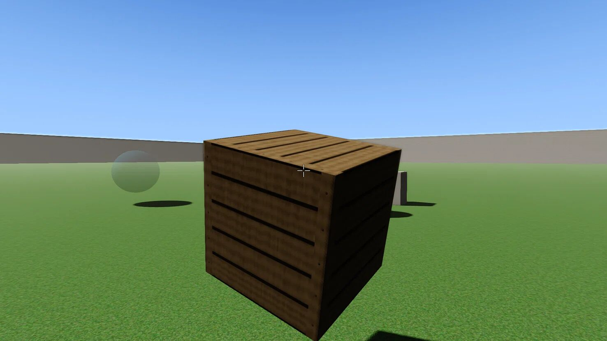
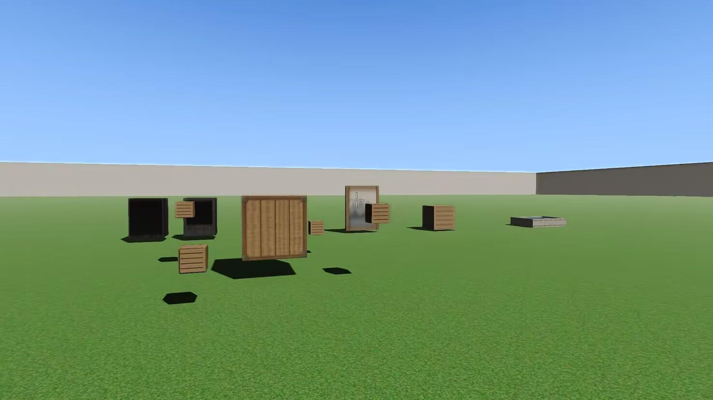
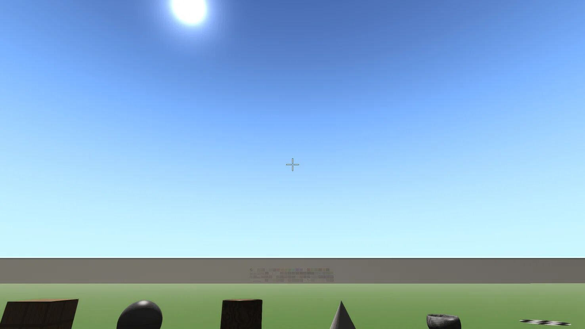
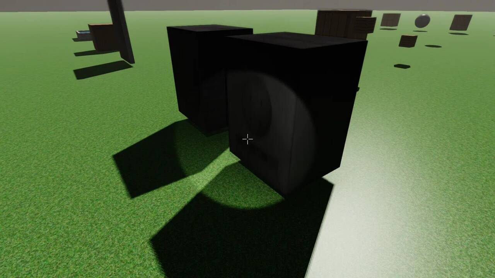
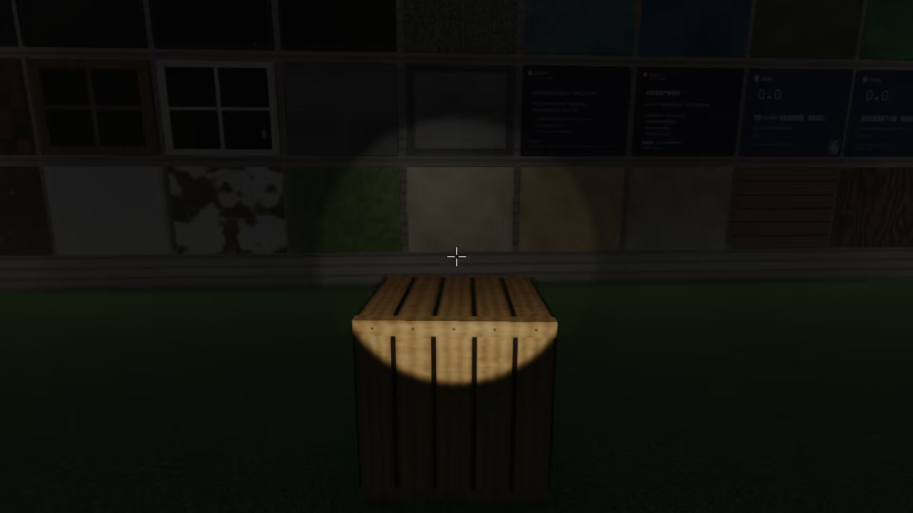
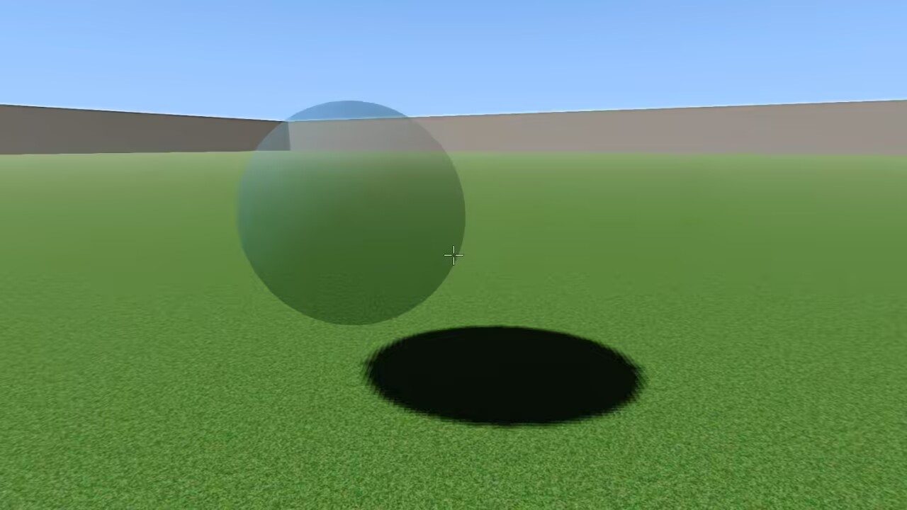
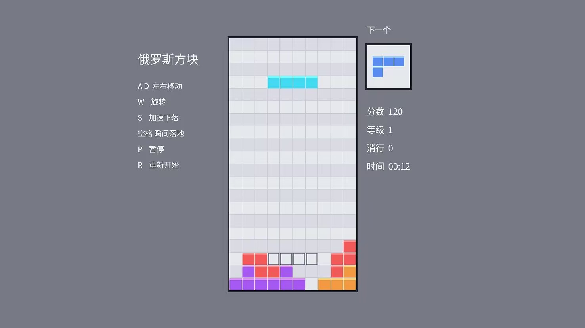

# Gvtcier Engine

跨平台 3D 游戏引擎（Windows / Android），从零自研。C++17 与 GLSL 460 编写，MIT 协议开源。

## 物理

刚体可以拿在手里随意搬运，物理与渲染实时联动。



## 光影与材质

延迟渲染，并行级联阴影。



## 天空

程序化天空穹顶与 HDR 太阳。



## 灯光阴影

任意点光 / 聚光都能投影，手电筒也是一盏普通的灯。





## 半透明



## 2D 渲染

独立的 2D 画布层，足够搭一整个 2D 游戏。



## 引擎内核

- 自绘 RHI，Windows 与 Android 共用同一套上层
- 资源三层查找，游戏打包成独立目录直接分发
- 内置 Gvts 脚本解释器（支持中文关键字）
- Jolt Physics、miniaudio、tinygltf 集成
- 标识符、注释、文档全中文

## 构建

```cmd
python build.py
```

## 许可

[MIT License](LICENSE)，第三方组件许可见 [Docs/THIRD-PARTY-NOTICES.md](Docs/THIRD-PARTY-NOTICES.md)。
